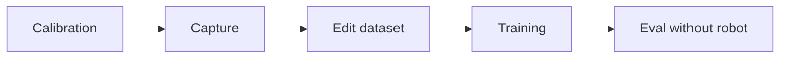
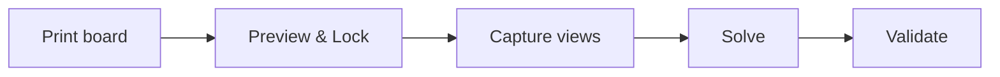
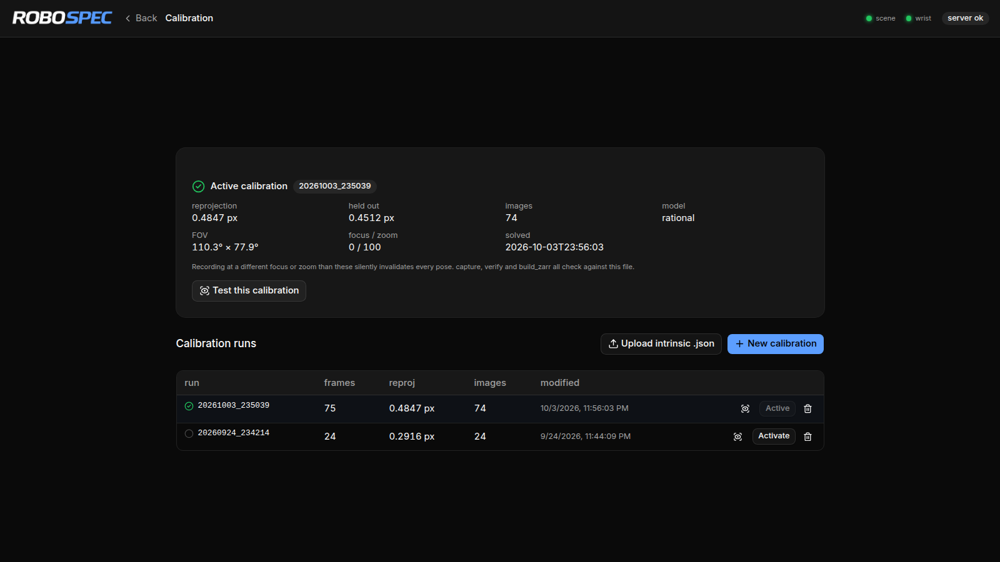
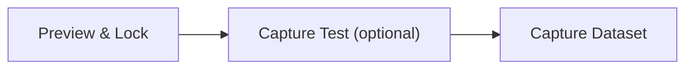
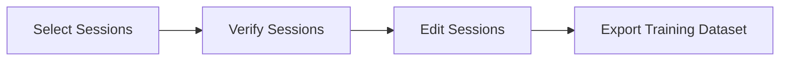
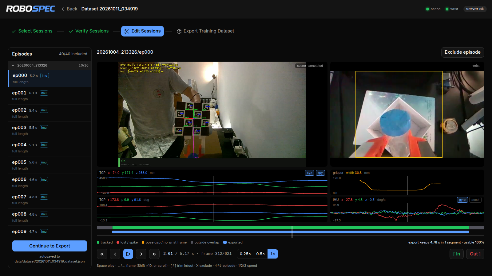
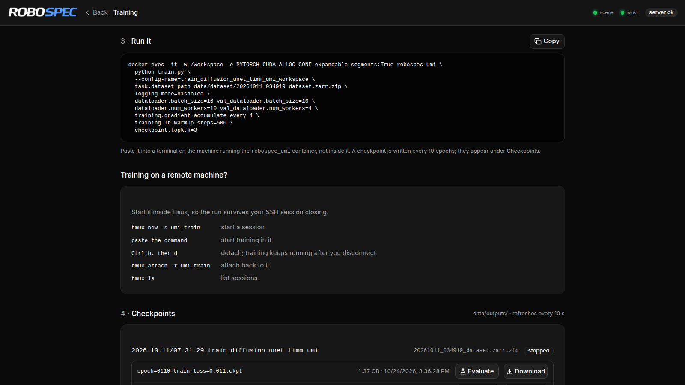
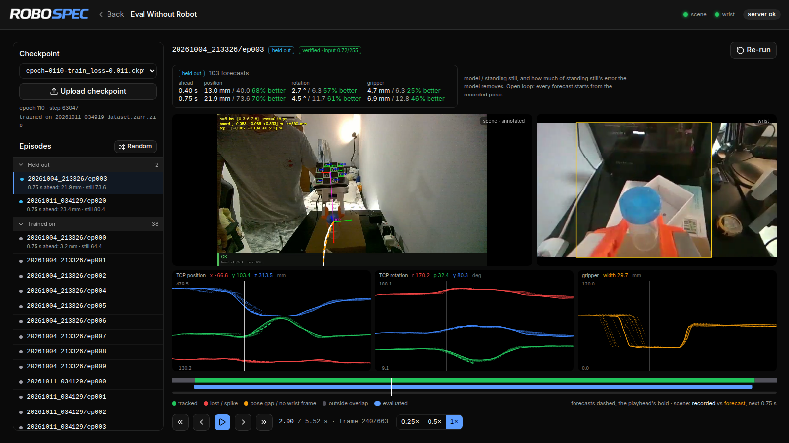

# robospec_umi

A UMI pipeline without SLAM or GoPro. A scene camera tracks a ChArUco board on
the handheld gripper for the TCP pose, a RealSense on the gripper is the wrist
camera, and an Arduino reads the gripper opening.

| Part | What | How | Status |
|---|---|---|---|
| [1. Data to policy](#part-1-data-to-policy) | calibration, capture, dataset editing, training, eval without robot | Docker + web UI | ready |
| [2. Eval with robot](#part-2-eval-with-robot-in-progress) | run the policy on the FR3 | conda env on the host | 🚧 in progress |

```
robospec_umi/
├── robospec_umi_calibration/   scene camera calibration
├── robospec_umi_capture/       recording
├── robospec_umi_dataset/       verify, ChArUco tracking, zarr export
├── robospec_umi_evaluation/    eval without robot
├── robospec_umi_franka/        eval with robot (design notes)
├── robospec_umi_ui/            web UI (React + Vite)
├── robospec_umi_server.py      UI server, the container's entrypoint
└── docs/                       ChArUco boards to print, screenshots

data/                           at the repo root
├── calibration/                scene_intrinsics.json is the active calibration
├── capture/<datetime>/epNNN/   recordings
├── dataset/                    <datetime>_dataset.json (edit project) + .zarr.zip (training input)
├── outputs/                    training runs and checkpoints
└── evaluation/<checkpoint>/    eval results
```

---

## Part 1: Data to policy

### Setup

Needs on the host:
- [Docker Engine](https://docs.docker.com/engine/install/ubuntu/), plus the
  [post-install steps](https://docs.docker.com/engine/install/linux-postinstall/)
  to run it without `sudo`
- [NVIDIA Container Toolkit](https://docs.nvidia.com/datacenter/cloud-native/container-toolkit/latest/install-guide.html),
  for the GPU in the container
- [Node.js 20.19+](https://nodejs.org/en/download), to build the UI

**1. Get the code**

```bash
git clone -b robospec_umi https://github.com/PiusLim373/universal_manipulation_interface.git
cd universal_manipulation_interface
```

**2. udev rules.** USB order changes between boots, so these give the scene
camera and the gripper fixed names (`/dev/scene_cam`, `/dev/gripper_sensor`) and
let the container open the RealSense.

```bash
sudo cp robospec_umi/99-decxin-cam.rules robospec_umi/99-gripper-sensor.rules /etc/udev/rules.d/
# wrist camera; skip if librealsense is already installed
sudo curl -fsSL -o /etc/udev/rules.d/99-realsense-libusb.rules \
    https://raw.githubusercontent.com/IntelRealSense/librealsense/v2.56.5/config/99-realsense-libusb.rules
sudo udevadm control --reload-rules && sudo udevadm trigger
ls -l /dev/scene_cam /dev/gripper_sensor      # replug the devices if missing
```

**3. Start the container.** The first `up` pulls
`ghcr.io/piuslim373/robospec-umi:oct_2026` (~16 GB).

```bash
export ROBOSPEC_UMI_DIRECTORY=$(pwd)
# only if `id -u` is not 1000:
# export ROBOSPEC_UID=$(id -u) ROBOSPEC_GID=$(id -g)
docker compose -f robospec_umi/robospec_umi_compose.yaml up -d
```

**4. Build the UI.** The repo is mounted into the container, so the running
server picks it up without a restart.

```bash
cd robospec_umi/robospec_umi_ui
npm ci && npm run build
```

Open <http://localhost:8080>. For a shell in the container:
`docker compose -f robospec_umi/robospec_umi_compose.yaml exec robospec bash`.

> The container is privileged with `/dev` mounted for the cameras, and the
> server has no login. Keep port 8080 off the public internet.

### Workflow



Each step is a tile on the home page, and the pipeline runs in that order.

### 1. Calibration



1. **Print board:** [`docs/calib.io_CHARUCO_270x190_5x7_30_22_DICT_4X4.pdf`](docs/calib.io_CHARUCO_270x190_5x7_30_22_DICT_4X4.pdf)
   at **Actual Size**, not "fit to page". A square must measure 30.0 mm.
2. **Preview & Lock:** locks focus and zoom. Focus and zoom change the lens
   geometry, so recording at a different setting than you calibrated at gives
   wrong poses that still look plausible.
3. **Capture views:** keep 40–60 still views until the coverage meters fill:
   all four frame corners, near and far, tilted every way.
4. **Solve:** reprojection error should be under ~0.5 px. The result becomes
   the active calibration.
5. **Validate:** **Test this calibration**. Walk the board into the corners;
   the error by radius should stay low, and the distance shown (camera to the
   board's origin corner) should match a tape measure.



### 2. Capture

Print [`docs/calib.io_CHARUCO_150x150_4x4_25_18_DICT_4X4.pdf`](docs/calib.io_CHARUCO_150x150_4x4_25_18_DICT_4X4.pdf)
at **Actual Size** (25 mm squares) for the gripper. You need the scene camera,
the wrist camera (RealSense D455 or D405) and the gripper Arduino plugged in.



1. **Preview & Lock:** both cameras live. Set exposure, white balance and so on,
   then lock.
2. **Capture Test:** record one throwaway episode and get a score with an
   annotated replay. Re-record until the setup scores well. Nothing is saved.
3. **Capture Dataset:** `SPACE` starts and stops each episode. **Finish & go
   to Edit** ends the session. Episodes go to `data/capture/<datetime>/epNNN/`.

### 3. Edit dataset



1. **Select Sessions:** pick sessions from `data/capture/`.
2. **Verify Sessions:** checks files, timestamps, and focus/zoom against the
   calibration. Episodes that fail are left out.
3. **Edit Sessions:** annotated scene video, wrist video with the training
   crop, and the TCP, gripper and IMU graphs. Trim with `[` / `]`, exclude with
   `X`. The bar under the graphs shows what export keeps.
4. **Export Training Dataset:** writes `data/dataset/<datetime>_dataset.zarr.zip`.

The project autosaves to `data/dataset/<datetime>_dataset.json`.



### 4. Training

1. Pick a dataset, or upload one.
2. Set the hyperparameters.
3. Click **Generate command** and paste it into a terminal on the host, not
   inside the container.

Checkpoints show up under **Checkpoints**, each with **Evaluate** and
**Download**. To train on a remote GPU machine, run the container there, upload
the dataset from this page, and start the command inside `tmux`.



### 5. Eval without robot

**Evaluation → Eval Without Robot** runs a checkpoint along a recording and
draws its forecasts over what the hand actually did.

1. **Pick a checkpoint** from `data/outputs/`. To use one trained on another PC,
   **Upload checkpoint**; it is filed under `data/outputs/` too.
2. **Pick an episode:**
   - **Held out:** never trained on, so the honest test.
   - **Trained on:** checks the plumbing.
   - **Other recordings:** anything else, e.g. a session shot after training.
   - **Random:** picks one for you.
3. **Run.** The model sees the raw wrist video with the same crop as training,
   and forecasts the next 0.75 s at every 50 ms step.

How to read it:
- **Graphs:** the recorded TCP and gripper are solid lines. Every forecast is a
  dashed stub off them, and the one at the playhead is bold.
- **Scene video:** the real next 0.75 s is white, and the forecast is amber.
- **"% better":** how much of the error from "standing still" (predicting no
  motion) the model removes. 0% means no better than not moving.

This is open loop: every forecast starts from the recorded pose. Errors compound
on a real robot, so treat these numbers as a lower bound. Results are saved in
`data/evaluation/<checkpoint>/`.



---

## Part 2: Eval with robot (in progress)

> 🚧 Not implemented or tested on the robot yet.

The policy runs on the FR3 from a conda env on the host. There is no Docker and
no UI.

**1. udev rule:** only the wrist camera is needed. Skip this if librealsense is
already installed.

```bash
sudo curl -fsSL -o /etc/udev/rules.d/99-realsense-libusb.rules \
    https://raw.githubusercontent.com/IntelRealSense/librealsense/v2.56.5/config/99-realsense-libusb.rules
sudo udevadm control --reload-rules && sudo udevadm trigger
```

**2. Conda env**

```bash
sudo apt install build-essential cmake patchelf libusb-1.0-0 \
    libspnav-dev spacenavd libosmesa6-dev libglfw3
conda env create -f robospec_umi/robospec_umi_conda.yaml
conda activate robospec_umi
python -c "import torch; print(torch.__version__, 'sm_120' in torch.cuda.get_arch_list())"
# expect: 2.7.0+cu128 True
```

**3. Design and next steps:** see [robospec_umi_franka/README.md](robospec_umi_franka/README.md).
